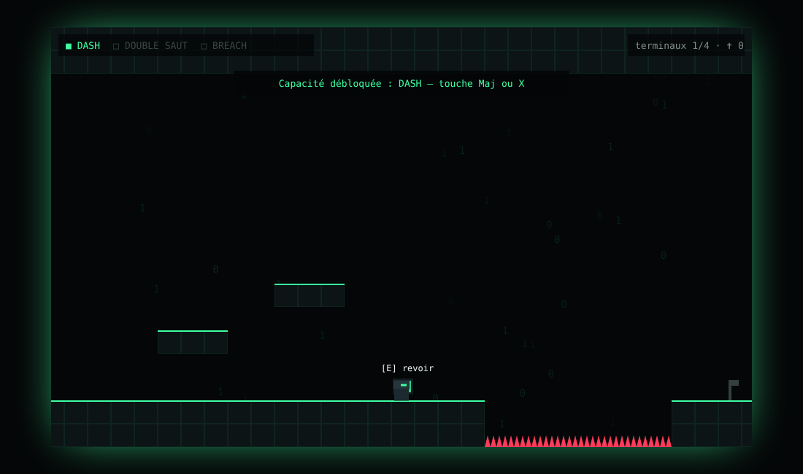
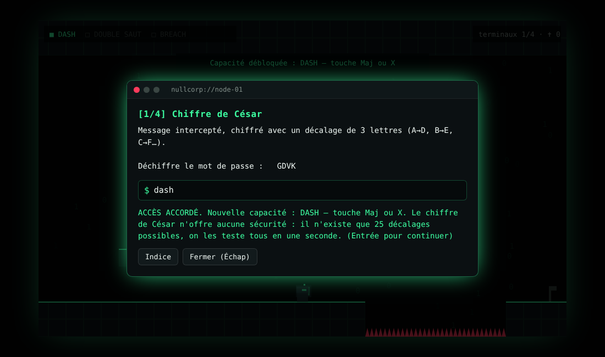

# 🕹️ BREACH — un metroidvania de hacking

**Un petit metroidvania jouable dans le navigateur où chaque capacité se gagne en résolvant un vrai défi de cybersécurité.**

Tu es infiltré dans le réseau de NULLCORP. Les terminaux disséminés dans le niveau
cachent des mini-défis : chiffre de César, Base64, injection SQL, reconnaissance via
`robots.txt`. Chaque terminal piraté débloque un pouvoir (dash, double saut, passage
du pare-feu) indispensable pour atteindre la zone suivante, comme dans Hollow Knight,
sauf que les clés sont des failles de sécurité.




## Jouer

Aucune installation : ouvre `index.html` dans un navigateur.

```bash
git clone https://github.com/Jimo0x/breach && cd breach
python3 -m http.server 8000   # puis http://localhost:8000 (ou double-clic sur index.html)
```

| Touche | Action |
|---|---|
| ← → / A D | se déplacer |
| Espace / ↑ / W | sauter (maintenir pour sauter plus haut) |
| Maj / X | dash (à débloquer) |
| E / Entrée | pirater un terminal |

## Les défis (et ce qu'ils enseignent)

| Terminal | Défi | Capacité | Leçon de sécurité |
|---|---|---|---|
| 1 | Chiffre de César | **Dash** | Un chiffrement à 25 clés se casse par force brute instantanément |
| 2 | Décodage Base64 | **Double saut** | Encoder n'est pas chiffrer |
| 3 | Injection SQL sur un formulaire de connexion | **Breach** (traverse le pare-feu) | Utiliser des requêtes préparées |
| 4 | Lecture de `robots.txt` | **Flag root** | `robots.txt` est public : il révèle ce qu'on veut cacher |

Pour le défi SQL, la requête construite par le serveur s'affiche **en direct** pendant
que tu tapes : on voit exactement comment l'injection casse la requête.

## Conception

- **Un seul fichier, zéro dépendance** : HTML + Canvas 2D + JavaScript.
- **Le niveau est généré par code** (`buildLevel()`) pour rester facile à modifier.
- **La progression est vérifiée par des tests** : un fossé de 8 cases infranchissable
  sans dash, un bloc de 5 cases infranchissable sans double saut, un pare-feu
  infranchissable sans Breach. Les tests simulent la physique du jeu dans Node
  et prouvent que chaque capacité est *nécessaire* et *suffisante*.

```bash
node tests/gates.test.js
```

## Idées pour la suite

- [ ] Nouvelles zones : XSS, cookies non signés, mots de passe faibles (hash + wordlist)
- [ ] Boss final : un « SOC » qui détecte tes actions si tu fais trop de bruit
- [ ] Sauvegarde de la progression (localStorage) et chronomètre speedrun
- [ ] Contrôles tactiles pour mobile

## Licence

MIT — voir [LICENSE](LICENSE).
# Breach
